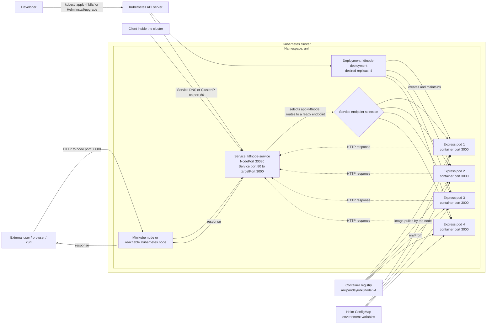

# Kubernetes Application Architecture and Traffic Flow

This diagram reflects the plain manifests in `k8s/`: namespace `anil`, a NodePort Service on `30080`, and four Node.js/Express pod replicas listening on port `3000`.



## External access on macOS with Minikube

With the Minikube Docker driver on macOS, the node's private IP may not be directly reachable from the Mac. Use Minikube's service helper to obtain a host-accessible URL:

```bash
minikube service k8node-service -n anil --url
```

Keep the helper running if it maintains a tunnel, and send HTTP requests to the URL it prints. `kubectl port-forward` is another local access method, but it forwards to one selected pod and does not demonstrate Service load balancing.

## In-cluster access

A client pod can call the Service through its DNS name or ClusterIP on port `80`:

```text
http://k8node-service.anil.svc.cluster.local/
```

The Service selects pods labeled `app: k8node` and forwards to their container port `3000`. It can route connections to any ready endpoint; this does not guarantee a different pod for each request.

## Scope

This project currently has an external/client path, Kubernetes Service networking, and an application tier. It does **not** define a separate database or persistence tier, so this is not a conventional three-tier application with presentation, business-logic, and data tiers. The ConfigMap shown above applies to the Helm chart; the plain Deployment manifest sets its environment variables directly.
